<div align="center">

# 💶 Girokonto – Smartphone-Konto mit Finanzassistent

**Projekt Informatik · WiSe 2026/27 · Frankfurt University of Applied Sciences**
Betreuung: Prof. Dr.-Ing. Ruth Schorr

[](https://github.com/p2keshtidar/girokonto/actions/workflows/ci.yml)
[](https://github.com/p2keshtidar/girokonto/releases/tag/latest)
[](https://github.com/p2keshtidar/girokonto/actions/workflows/e2e.yml)


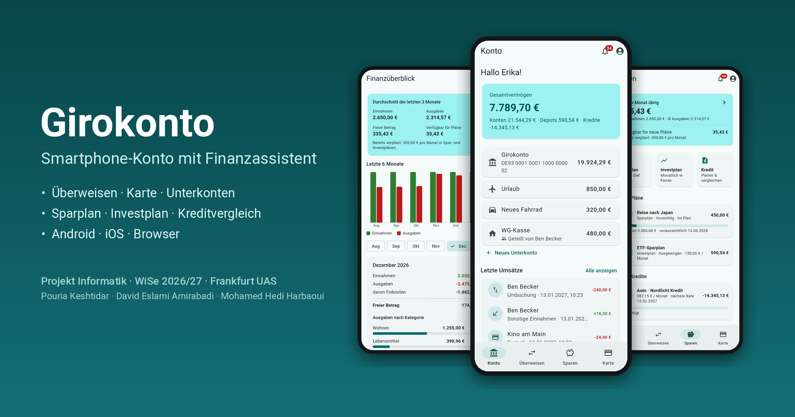

</div>

> [!NOTE]
> Alle Konten, IBANs, Banken und Beträge sind **simuliert**. Es wird kein echtes Geld bewegt.

---

## ⬇️ Download – fertige Apps

GitHub baut bei jeder Änderung automatisch alle Apps neu. Einfach anklicken:

| | Datei | Wofür |
|---|---|---|
| 🤖 | **[girokonto.apk](https://github.com/p2keshtidar/girokonto/releases/latest/download/girokonto.apk)** | Android-App fürs Handy |
| 🍏 | **[girokonto-ios-unsigned.ipa](https://github.com/p2keshtidar/girokonto/releases/latest/download/girokonto-ios-unsigned.ipa)** | iPhone-App (ohne Signatur, Installation siehe Anleitung) |
| 🖥️ | **[girokonto-server.jar](https://github.com/p2keshtidar/girokonto/releases/latest/download/girokonto-server.jar)** | Server **mit Web-App** – läuft auf deinem PC |
| 🌐 | [girokonto-web.zip](https://github.com/p2keshtidar/girokonto/releases/latest/download/girokonto-web.zip) | nur die Web-App (statische Dateien) |

Alle Dateien auf einen Blick: **[Releases → Aktuelle Version](https://github.com/p2keshtidar/girokonto/releases/tag/latest)**

📱 Läuft auf **Android 7.0 bis 16** und **iOS 15 bis 26** – das sind die ältesten Versionen, die Flutter unterstützt. Automatisch getestet auf Android 7, 8, 9, 11, 13, 15, 16 und iOS 16, 17, 18, 26 → [Details](docs/technik/versionen.md)

> [!IMPORTANT]
> Die Apps brauchen den **Server** auf deinem PC. Wie das in 5 Minuten geht, steht in der
> **[📖 Schritt-für-Schritt-Anleitung](docs/anleitung/01-installieren.md)**.

---

## 🚀 Schnellstart (3 Schritte)

```bash
# 1. Datenbank starten (Docker Desktop muss laufen)
docker run -d --name girokonto-db -p 5432:5432 -e POSTGRES_DB=girokonto -e POSTGRES_USER=girokonto -e POSTGRES_PASSWORD=girokonto postgres:16-alpine

# 2. Server starten (Java 21) – die Datei vorher oben herunterladen
java -jar girokonto-server.jar

# 3. Im Browser öffnen
#    http://localhost:8080
```

Handy verbinden: App öffnen → unten auf der Login-Seite **„Server: …“** antippen → `http://<IP-deines-PCs>:8080` eintragen.

---

## 📸 So sieht die App aus

| | | | |
|:-:|:-:|:-:|:-:|
| 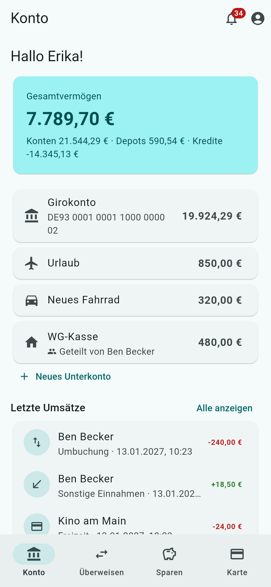<br>Startseite | 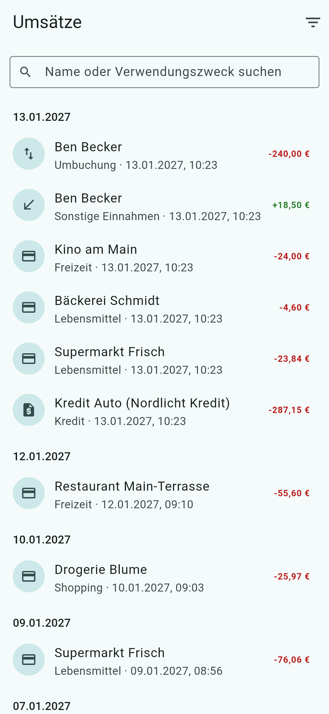<br>Umsätze | 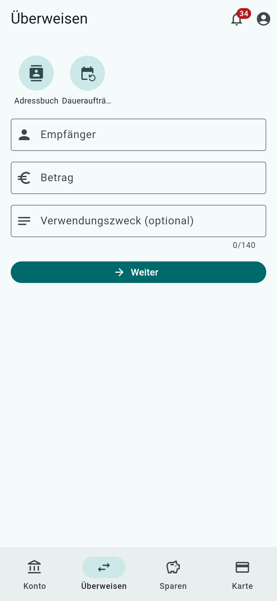<br>Überweisen | 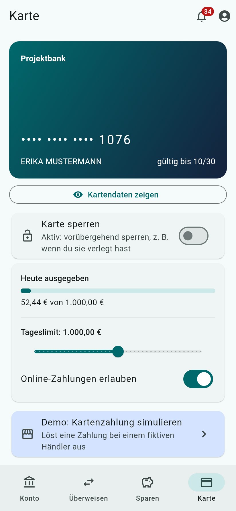<br>Karte |
| 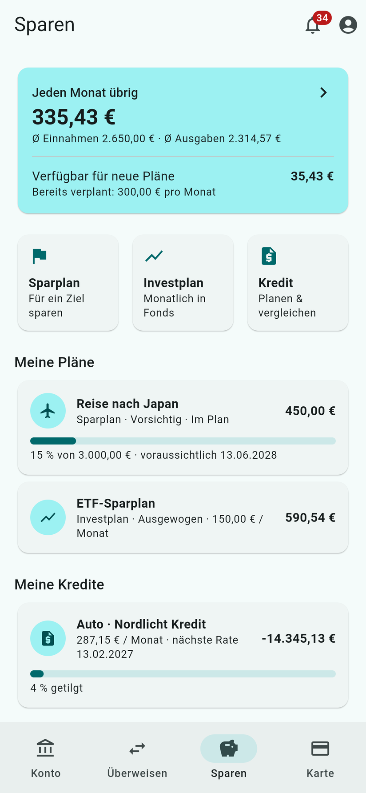<br>Sparen | 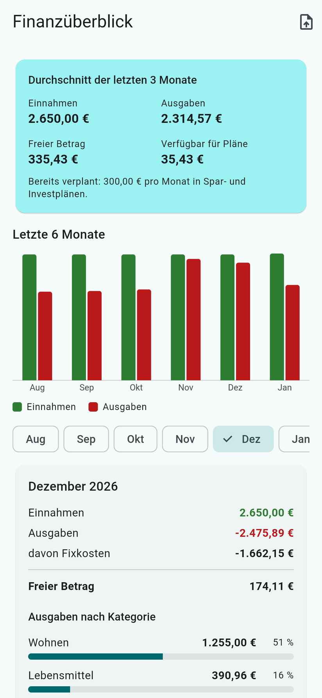<br>Finanzüberblick | 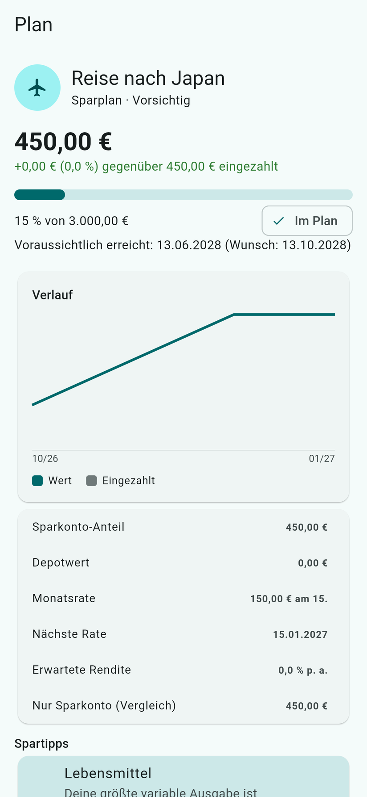<br>Sparplan | 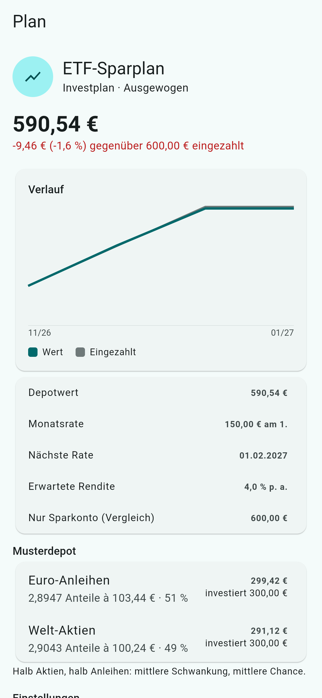<br>Investplan |
| 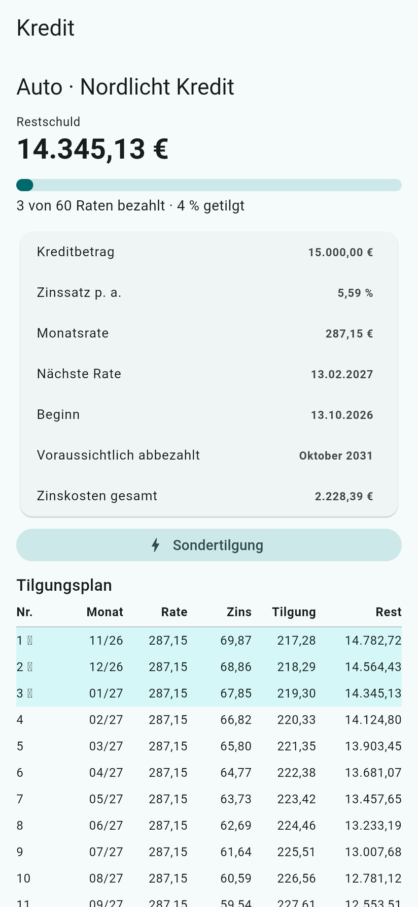<br>Kredit + Tilgungsplan | 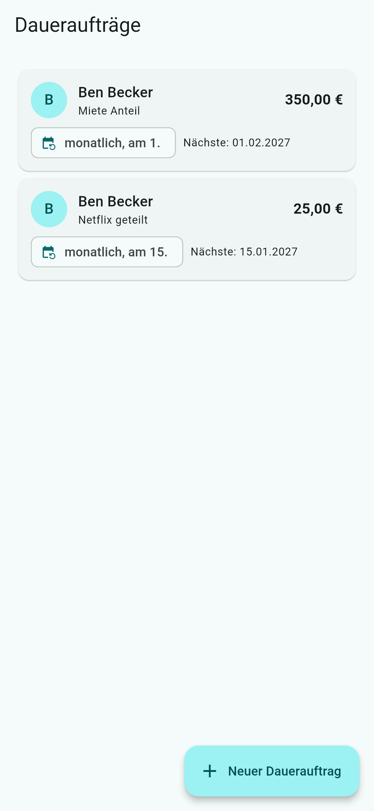<br>Daueraufträge | 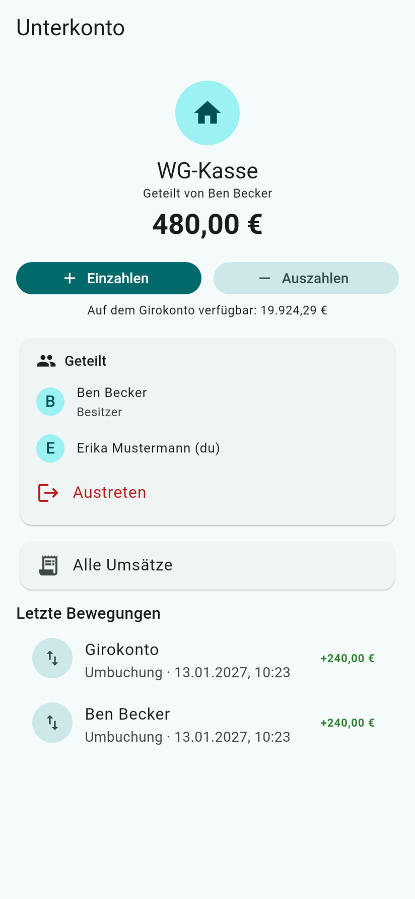<br>Geteiltes Unterkonto | 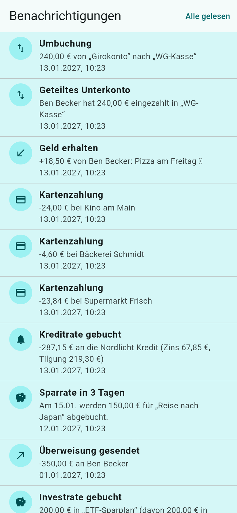<br>Benachrichtigungen |

Alle Bilder in voller Größe: [`docs/bilder`](docs/bilder) – auch für Präsentation und Bericht.

---

## ✨ Was kann die App?

| Bereich | Funktionen |
|---|---|
| 🏦 **Girokonto** | Registrierung mit fiktiver IBAN und 1.000 € Startguthaben · Umsätze mit Suche und Filter · Kategorien · **eigene Einnahmen & Ausgaben eintragen** (Gehalt, Miete, Urlaub – einmalig oder regelmäßig) |
| 🧾 **Finanz-Dashboard** | Gesamtvermögen nach Bestandteilen · verfügbar und zurückgelegt getrennt · **Vermögensverlauf** (12 Monate) · Cashflow · größte Ausgaben · Schulden mit Raten-Quote · Sparziele · Konten und Karten mit veraltet-Hinweis |
| 🏛️ **Weitere Konten** | **weiteres Girokonto** mit eigener IBAN und **Tagesgeld** mit fiktivem Zinssatz (Simulation, Zinsen tagesgenau, Gutschrift monatlich) · **Umbuchen** zwischen eigenen Konten · **alle Umsätze** (Projektbank + verbundene Banken) an einem Ort |
| 💸 **Überweisen** | per IBAN, E-Mail oder Telefonnummer · Adressbuch · Abgleich mit Handy-Kontakten · Tageslimit · **Daueraufträge** (monatlich bis jährlich) |
| 💳 **Karte** | virtuelle Debitkarte · Daten nur mit Passwort · sperren/entsperren · Limit · Demo-Kartenzahlung |
| 🗂️ **Digitale Konten** | Töpfe für Urlaub, Auto, Immobilie, WG … mit **Zielbetrag, Fortschritt, Restbetrag und nötiger Monatsrate** · klar getrennt von Bankkonten (kein eigenes Bankkonto, keine eigene Einlagensicherung) · **teilen mit Rechten** (einzahlen + auszahlen / nur einzahlen / nur ansehen) · **Sparregeln** (wöchentlich bis vierteljährlich, vom Girokonto oder als Vormerkung bei einer verbundenen Bank) mit Status, Wiederholung und Prognose |
| 🔔 **Benachrichtigungen** | live per WebSocket bei jeder Buchung · Android: auch bei **geschlossener App** (Hintergrund-Abfrage) |
| 🏦 **Echte Bankkonten** | mehrere Banken verbinden (Open Banking/PSD2, **nur Lesezugriff**) · Sandbox-Banken mit Testdaten · Abruf, Vormerkungen, Stornos, Rückbuchungen · eigene Kategorien, Notizen, Schlagwörter · Widerruf mit Löschen |
| 🌍 **Deutsch / Englisch** | Sprache umschalten (auch Server-Meldungen), pro Konto gespeichert, beim ersten Start Gerätesprache |
| 📊 **Finanzüberblick** | Einnahmen/Ausgaben pro Monat · Kategorien · „Jeden Monat übrig“ · **CSV-Import** von Umsätzen echter Banken |
| 🔐 **Sicherheit** | Passwort-Hash, JWT, Sperre nach Fehlversuchen · **Zwei-Faktor-Anmeldung** mit Authenticator-App |
| 🐷 **Sparplan** | Ziel + Datum → Ratenvorschlag · Risikostufe · Ampel „machbar?“ · Spartipps · **Erinnerung vor der Abbuchung** |
| 📈 **Investplan** | z. B. 200 €/Monat in fiktive Fonds · Musterdepot mit Verlauf |
| 🚗🏠 **Kreditplan** | Auto/Immobilie/Sonstiges · Rechenbeispiele von 4 fiktiven Banken mit **Bonität, Filtern, Sollzins und effektivem Jahreszins** · Bundesbank-Durchschnitt als Referenz · **getrennte Schritte: Anfrage → Vertrag → Auszahlung** · Tilgungsplan · **Sondertilgung** mit Vorschau (Restschuld, Laufzeit, Zinsersparnis) |
| ⏩ **Demo-Modus** | Beispielmonate erzeugen · Admin spult die Zeit vor (Raten werden gebucht) |

Demo-Admin: `admin@projektbank.de` / `admin12345`

---

## 📚 Dokumentation

| Dokument | Inhalt |
|---|---|
| 📖 [Anleitung: Installieren](docs/anleitung/01-installieren.md) | Server starten, Android, iPhone, Browser – Schritt für Schritt |
| 🧭 [Anleitung: App ausprobieren](docs/anleitung/02-app-benutzen.md) | Geführter Rundgang durch alle Funktionen |
| 🛠️ [Anleitung: Entwickeln](docs/anleitung/03-entwickeln.md) | Projekt aus dem Code starten, Tests, Git-Arbeitsweise |
| 🆘 [Häufige Probleme](docs/anleitung/04-probleme.md) | Lösungen für typische Fehler |
| 🏗️ [Architektur](docs/technik/architektur.md) | Wie Backend und App aufgebaut sind |
| ✅ [Testbericht](docs/technik/testbericht.md) | Was getestet wird, Abdeckung, gefundene Fehler |
| 📱 [Unterstützte Versionen](docs/technik/versionen.md) | Android 7+ / iOS 15+, was sich zwischen den Versionen unterscheidet, wie getestet wird |
| 🏦 [Echte Bankkonten (Open Banking)](docs/technik/open-banking.md) | Ablauf, Anbieter, Sicherheit, Status der Umsätze, Voraussetzungen für echte Banken |
| 🐷 [Sparregeln und Kreditvergleich](docs/technik/sparregeln-und-kredite.md) | Finanzierungsquellen, Status, keine doppelten Abbuchungen; Anbieter, Rechenbeispiele, Bundesbank-Referenz, getrennte Kreditschritte |
| 🔔 [Push-Benachrichtigungen](docs/technik/push.md) | Hintergrund-Abfrage und Weg zu echtem Push (Firebase/APNs) |
| 📄 [Pflichtenheft v0.2](docs/pflichtenheft/Pflichtenheft_Girokonto_v0.2.pdf) | Anforderungen (Muss-/Kannkriterien, Tests) |
| 🏃 [Scrum](docs/scrum/README.md) | Projektwoche 12.–18.10.2026: Rollen, 7 Tages-Sprints, Aufgabenverteilung, Protokolle |
| 🧭 [Weiterentwicklung](docs/weiterentwicklung.md) | 22 Vorschläge vom 15.10.: was es schon gibt, was in Sprint 6/7 geplant ist, Reihenfolge |
| ✅ [Backlog (Issues)](https://github.com/p2keshtidar/girokonto/issues) · [Sprints (Milestones)](https://github.com/p2keshtidar/girokonto/milestones) | Aufgaben und Stand |

---

## 🗂️ Aufbau des Repositorys

```
girokonto/
├── app/                    📱 Flutter-App (Android, iOS, Browser)
│   ├── lib/                   Quellcode (core/ + features/)
│   ├── test/                  Unit- und Widget-Tests
│   ├── integration_test/      Ende-zu-Ende-Test (echte App gegen echten Server)
│   └── tool/                  Hilfsskript für die Plattform-Einstellungen
├── backend/                ☕ Spring-Boot-Server (Java 21, PostgreSQL)
│   └── src/main/…             Code, Datenbank-Migrationen (Flyway)
├── docs/                   📚 Anleitungen, Architektur, Pflichtenheft, Scrum, Bilder
├── .github/                ⚙️ automatische Tests + Builds (GitHub Actions), Vorlagen für Issues/PRs
├── Dockerfile              🐳 baut Server + Web-App in ein Image
└── docker-compose.yml      🐳 startet Datenbank (+ optional die ganze Anwendung)
```

## 🧪 Qualität

Bei jedem Push prüft GitHub automatisch ([Actions](https://github.com/p2keshtidar/girokonto/actions)):

- **Backend:** 232 Tests mit echter PostgreSQL-Datenbank, **92,7 % Zeilenabdeckung** – Testfälle T01–T84, Sicherheitsmatrix über *alle* Endpunkte, Fuzzing, gleichzeitige Überweisungen, 160 Zufallsaktionen mit Prüfung der Buchhaltung, Bankverbindungen gegen Sandbox und nachgebildeten Anbieter, parallele Sparregel-Läufe ohne doppelte Abbuchung
- **App:** `flutter analyze` + 293 Unit-/Widget-Tests – jeder Bildschirm in 4 Formaten (kleines Handy bis Tablet, Schrift 150 %) und auf Englisch, Abläufe mit simuliertem Server
- **Sicherheit:** gitleaks (Geheimnisse), Trivy (Abhängigkeiten, Docker), CodeQL, Dependabot
- **Builds:** Web, Android-APK, iOS, Docker-Image
- **Ende-zu-Ende** (manuell: *Actions → E2E → Run workflow*, Plattform, Android-Gerät und Systemversionen wählbar): echte App im Browser (Chrome), Android-Emulatoren (**Android 7, 8, 9, 11, 13, 15, 16**; Pixel 5 oder sehr kleines Display) und iPhone-Simulatoren (**iOS 16, 17, 18, 26**) gegen den echten Server, mit Bildschirmfotos je Version – registrieren, Karte, Überweisung, Beispielmonate, Finanzüberblick, Kreditvergleich, Kredit in vier Schritten (Vergleich, Anfrage, Vertrag, Auszahlung), Sondertilgung, Sandbox-Bank, **zwei Nutzer** (Live-Meldung, Überweisung, Dauerauftrag, geteiltes digitales Konto, Sparregel)

📋 Alle Details: **[Testbericht](docs/technik/testbericht.md)**

## 👥 Team

| Name | Rolle |
|---|---|
| Pouria Keshtidar | Product Owner · Backend |
| David Eslami Amirabadi | Scrum Master · App (Flutter) |
| Mohamed Hedi Harbaoui | Entwicklung · Tests, CI & Plattformen |

Rollenverteilung ist ein Vorschlag aus dem Kick-off – Details und Ablauf: [docs/scrum](docs/scrum/README.md)

<div align="center"><sub>Projekt Informatik · FRA-UAS · 12.10.2026 – 27.01.2027</sub></div>
