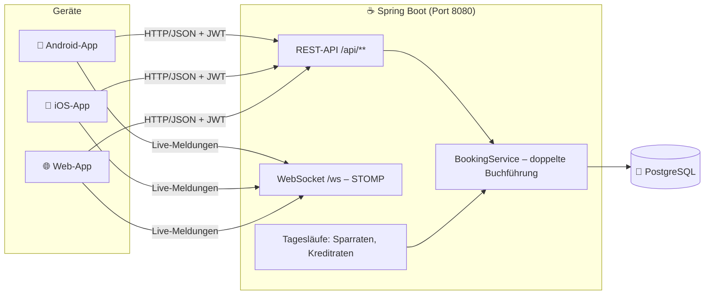

# 🏗️ Architektur

[← Übersicht](../../README.md)

## Überblick

| Schicht | Technik |
|---|---|
| App | Flutter (Dart), Riverpod (Zustand), go_router (Navigation), dio (HTTP), STOMP (Live-Meldungen) |
| Server | Java 21, Spring Boot 3, Spring Security + JWT, JPA/JDBC, Flyway, springdoc (Swagger) |
| Datenbank | PostgreSQL 16 |
| Qualität | JUnit 5 + Testcontainers, flutter_test, integration_test, GitHub Actions |

## Umfang nach Phasen

| Phase | Backend | App |
|---|---|---|
| 1 Grundgerüst | Registrierung mit fiktiver IBAN und 1.000 € Startguthaben, Login mit JWT, Refresh-Token, Abmeldung, Sperre nach 5 Fehlversuchen, Profil, Kontoliste, doppelte Buchführung | Login, Registrierung, automatische Anmeldung, Navigation mit 4 Bereichen, Startseite, Profil, heller/dunkler Modus |
| 2 Konto | Umsätze mit Filter (Zeitraum, Richtung, Betrag, Art), Freitextsuche und Seiten; Überweisung per IBAN, E-Mail oder Telefon mit Prüfung von Deckung, Tageslimit 5.000 €, Selbstüberweisung; Zeilensperre gegen parallele Überweisungen; Idempotenz-Schlüssel gegen Doppelbuchungen; Adressbuch und Abgleich mit Telefonnummern | Letzte Umsätze auf der Startseite, Umsatzliste mit Suche, Filter, Tagesgruppen und Nachladen, Umsatzdetail, Überweisung in 3 Schritten (Eingabe, Zusammenfassung, Senden), Erfolgsseite, Adressbuch mit Schnellauswahl und Gerätekontakten |
| 3 Karte, Töpfe, Meldungen | Virtuelle Karte (Luhn-gültige Nummer, AES-GCM-verschlüsselt), Details nur mit Passwort, sperren/entsperren, Tageslimit bis 2.000 €, Online-Schalter, Händler-Simulator; Unterkonten anlegen, umbenennen, umbuchen, auflösen (max. 10); Benachrichtigungen bei jeder Buchung, Live-Versand per WebSocket (STOMP, JWT) nach dem Commit | Bereich „Karte“ mit Kartenbild, Daten 30 s sichtbar, Sperr-Schalter, Limit-Regler, Demo-Zahlung; Unterkonten auf der Startseite mit Detailseite (einzahlen, auszahlen, bearbeiten, auflösen); Glocke mit Zähler, Benachrichtigungsliste, Live-Meldung als Hinweis bzw. Systembenachrichtigung |
| 4 Finanzassistent | Kategorien je Buchungszeile, Monatsübersicht und Durchschnitt, Demo-Profile mit Beispielmonaten; Spar- und Investpläne mit Prognose, Ratenvorschlag, Ampel, fiktiven Fonds und Musterdepot; Kreditangebote von 4 fiktiven Banken (Annuität, Tilgungsplan), Abschluss und monatliche Raten; Simulationsuhr mit Tagesläufen und Admin-Vorspulen | Finanzüberblick mit Diagrammen, Kategorie ändern, Bereich „Sparen“ mit Plan-Assistent und Plan-Detail, Kreditplaner, Angebotsvergleich, Tilgungsplan, Kreditdetail, Demo-Modus im Profil |
| 5 Kannkriterien | /K010/ Erinnerung an die Sparrate: Spalte `reminder_days` (Standard 3, 0 = aus), Tageslauf meldet X Tage vor der Abbuchung, warnt bei zu wenig Guthaben, höchstens einmal pro Monat; /K020/ Sondertilgung: Tabelle `loan_extra_payment`, Buchungsart `LOAN_EXTRA`, Vorschau und Buchung, Tilgungsplan mit fester Rate und Sondertilgungen (`LoanMath.schedule(…, extras)`), Laufzeit und Zinsen sinken | Einstellung „Erinnerung vor der Abbuchung“ im Plan, Seite „Sondertilgung“ mit Schnellbeträgen, Vorher-/Nachher-Vergleich und Zinsersparnis; Kreditdetail zeigt voraussichtliches Ende, Sondertilgungen und gesparte Zinsen; Dialoge auf kleinen Bildschirmen scrollbar |
| 6 Weitere Kannkriterien | /K030/ Daueraufträge (`standingorder`, Tageslauf Nr. 25, Ausführung über `TransferService` mit Idempotenz-Schlüssel); /K050/ Zwei-Faktor-Anmeldung (`Totp` nach RFC 6238 ohne Zusatzbibliothek, Schlüssel AES-GCM-verschlüsselt, Prüfung in echter Zeit, Schutz vor Wiederverwendung); /K040/ CSV-Import (`csvimport`, erkennt Spalten deutscher Banken, Duplikatschutz per SHA-256, eigene Tabelle – zählt im Finanzüberblick, ändert keine Kontostände); /K060/ geteilte Unterkonten (`account_member`, Zugriff über `AccountService.requireAccess`); Simulationsuhr rechnet in Kalendertagen (Zeitumstellung) | Daueraufträge (Liste, Anlegen, Ändern, Pausieren); Zwei-Faktor-Einrichtung mit QR-Code, Code-Feld beim Login; CSV-Import-Seite mit Beispieldatei; Teilen-Bereich im Unterkonto; Android-Hintergrundabfrage für Meldungen bei geschlossener App (WorkManager) |

| Tests | Inhalt |
|---|---|
| Backend | IBAN, Buchungsregel, Telefonnummern, Luhn-Prüfziffer, Verschlüsselung, Kategorien, Prognose/Ratenvorschlag, Fondspreise, Annuität/Tilgungsplan, Tilgungsplan mit Sondertilgung; Integrationstests mit echter Datenbank für T01 bis T40 (Login, Überweisung, Karte, Unterkonten, Beispielmonate, Kategorie ändern, Machbarkeit, Spar- und Investplan mit Vorspulen, Auszahlen, Kreditangebote, Abschluss, Kreditrate, Ablehnung, Admin-Recht, Erinnerung, Sondertilgung, ungültige Sondertilgung, Komplett-Rückzahlung, Daueraufträge, Zwei-Faktor-Anmeldung, CSV-Import, geteilte Unterkonten) |
| App | Geldformat und -eingabe, Eingabeprüfungen, Filter-Parameter, Idempotenz-Schlüssel, Kartendaten, Benachrichtigungen, Monatsübersicht, Pläne, Kredite, Login-Formular |

---

### Backend (`backend/src/main/java/de/frauas/girokonto`)

| Paket | Aufgabe |
|---|---|
| `auth` | Registrierung, Login, JWT, Refresh-Token, Sicherheitskonfiguration |
| `user` | Benutzer-Entität, Profil anzeigen/ändern, Passwort ändern |
| `account` | Konten; beim Registrieren wird das Girokonto mit IBAN angelegt; Endpunkt für Umsätze |
| `booking` | **Einzige Stelle, die Geld bewegt** (`BookingService`). Jede Buchung hat mind. zwei Zeilen mit Summe 0. `BookingQueryService` liest Umsätze mit Filtern |
| `transfer` | Überweisungen: Empfänger finden (`RecipientResolver`), prüfen und buchen (`TransferService`) |
| `contact` | Adressbuch und Abgleich mit Telefonnummern aus dem Handy |
| `card` | Virtuelle Karte: Nummer erzeugen (Luhn), verschlüsseln (`CardCrypto`, AES-256-GCM), sperren, Limits, Händler-Simulator |
| `subaccount` | Digitale Konten (früher Unterkonten): anlegen mit Zweck/Ziel, ändern, umbuchen, teilen mit Rollen, auflösen |
| `banking` | Echte Bankkonten über Open Banking/PSD2 (nur lesen): Anbieter-Schnittstelle, Sandbox, GoCardless, Abgleich, Widerruf – siehe [Open Banking](open-banking.md) |
| `audit` | Prüfprotokoll sicherheitsrelevanter Aktionen (`GET /api/me/audit-log`) |
| `i18n` | Englische Server-Texte (`ServerTexts`, `en.tsv`), Übersetzung der Antworten bei `Accept-Language: en` |
| `notification` | Benachrichtigungen speichern, auflisten, gelesen markieren; WebSocket-Konfiguration (`WebSocketConfig`) |
| `insights` | Kategorien (`CategoryService`), Monatsübersicht und Durchschnitte (`InsightsService`), Demo-Profile und Beispielmonate (`DemoDataService`) |
| `savings` | Spar- und Investpläne (`SavingsPlanService`), Risikostufen, fiktive Fonds (`Fund`), Prognoseformeln (`PlanMath`) |
| `loan` | Kreditzwecke und Zinsregeln (`LoanPurpose`), fiktive Banken (`Bank`) mit Mindest-Bonität, Bonitätsklassen (`CreditClass`), Annuitätenrechnung (`LoanMath`), Vergleich mit Filtern, getrennte Schritte Anfrage → Vertrag → Auszahlung, Raten (`LoanService`) |
| `loan/provider` | Anbieter-Schnittstelle `LoanOfferProvider`, fiktive Banken (`SimulatedBanksProvider`), Referenzzinsen der Bundesbank (`MarketRateService`) – siehe [Sparregeln und Kredite](sparregeln-und-kredite.md) |
| `dashboard` | Zentrales Finanz-Dashboard (`GET /api/dashboard`): Gesamtvermögen nach Bestandteilen, verfügbar/zurückgelegt, Konten und Karten, Schulden mit Verhältnis zu den Einnahmen, Cashflow, Sparziele, größte Ausgaben, Vermögensverlauf (12 Monatsenden) |
| `market` | Finanz-Marktplatz: Anbieter-Schnittstelle `MarketProvider`, fiktive Anbieter (`SimulatedMarketProvider`), Vergleich mit Beispielrechnung, Favoriten, Vergleichsliste, simulierte Anträge mit Unterlagen (Tageslauf Nr. 55) |
| `creditcard` | Kreditkarte (Simulation): Verfügungsrahmen, Sperre, Demo-Zahlung mit Auslandseinsatz, Monatsabrechnung vom Girokonto über `BookingService` (Tageslauf Nr. 60, ohne Dispo – offene Abrechnung wird täglich erneut versucht) |
| `health` | Finanz-Check: interner Punktwert 0–100 aus Sparquote, Notgroschen, Kreditraten und Budgets – nur mit Einwilligung (V24, widerrufbar), keine Bonitätsbewertung |
| `group` | Gemeinsame Ausgaben: Gruppen, Ausgaben mit Aufteilung (gleichmäßig oder feste Anteile), Salden, Ausgleichsvorschläge (wenige Zahlungen), Ausgleich per Überweisung über `TransferService` oder bar (nur vom Empfänger bestätigt) |
| `assistant` | Finanzassistent: regelbasierte Fragen (Kategorien, Monate, Sparpotenzial, Monatsende, Budgets) aus `InsightsService`, `BudgetService` und `ForecastService`; Monatsbericht; Szenarien aus den Durchschnittswerten – keine externe KI |
| `contract` | Verträge: Kosten je Monat/Jahr, Laufzeit- und Fristberechnung, Erinnerung im Tageslauf (Nr. 65); Dokumente: nur PDF/PNG/JPEG bis 5 MB (Prüfung am Inhalt), AES-256-GCM-verschlüsselt in der Datenbank (Schlüssel aus `CARD_KEY` abgeleitet), SHA-256-Prüfsumme, Abruf nur durch den Besitzer als Anhang mit `nosniff` |
| `planner` | Zentraler Planer: Ansparen, Finanzieren, Anzahlung + Kredit für Reise/Auto/Immobilie aus Finanzüberblick und Kreditvergleich (nichts wird angelegt) |
| `subaccount` (Karten) | Demo-Karte je digitalem Konto (V25, ohne Kartennummer): Zahlung bucht vom digitalen Konto, Tageslimit, Sperre, nur Besitzer/volle Rechte |
| `planning` | Budgets mit Warnungen (Tageslauf Nr. 50), ungewöhnliche Ausgaben, Prognose des Girokontos |
| `multibank` | Weitere Konten der Projektbank (`CURRENT` = weiteres Girokonto, `CALL` = Tagesgeld), Zinsen (`InterestService`, Tageslauf Nr. 45, `InterestMath`), Umbuchen zwischen eigenen Konten, alle Umsätze (`ConsolidatedService`) |
| `allocation` | Sparregeln für digitale Konten: Rhythmen, Quellen (Girokonto = Umbuchung, verbundenes Bankkonto = Vormerkung), Vorgänge mit Status und Wiederholung, Tageslauf Nr. 35 |
| `simulation` | Verschiebbare Uhr (`SimulationClock`), Tagesläufe (`SimulationService`, `DailyJob`), nächtlicher Lauf (`DailyScheduler`), Admin-Endpunkt zum Vorspulen |
| `common` | IBAN-Generator, einheitliche Fehlermeldungen |
| `config` | Einstellungen aus `application.yml`, zentrale Uhr (später für den Demo-Modus) |

**Ablauf Registrierung:** `AuthController.register` → `AuthService.register` (prüft Alter, doppelte E-Mail/Telefon) → Benutzer speichern → `AccountService.openMainAccount` (nächste Kontonummer aus der Datenbank-Sequenz, IBAN nach ISO 13616) → `BookingService.post` bucht 1.000 € vom System-Konto `BANK` auf das neue Konto → `TokenService.issue` gibt Access- und Refresh-Token zurück. Alles läuft in **einer** Datenbanktransaktion: schlägt ein Schritt fehl, wird nichts gespeichert.

**Kontostand:** wird nie als Zahl gespeichert, sondern immer als Summe aller Buchungszeilen des Kontos berechnet (`BookingLineRepository.balanceOf`). Die Summe aller Buchungszeilen im System ist immer 0 (Test T15).

**Anmeldung und Sicherheit:**
* Passwörter nur als BCrypt-Hash.
* Access-Token (JWT) 15 Minuten gültig, enthält Nutzer-ID, Rolle und `ver` (Token-Version).
* Refresh-Token 7 Tage gültig, in der Datenbank nur als SHA-256-Hash, jedes nur einmal nutzbar.
* Abmelden erhöht die Token-Version, dadurch sind alte Access-Tokens sofort ungültig.
* Nach 5 falschen Passwörtern ist die Anmeldung 5 Minuten gesperrt (HTTP 423).
* `JwtAuthFilter` prüft bei jeder Anfrage das Token; Controller erhalten den Nutzer über `@AuthenticationPrincipal AuthUser`. Daten werden immer nur für diese Nutzer-ID geladen.

**Ablauf Überweisung (`TransferService.execute`):**
1. Girokonto des Senders mit `SELECT ... FOR UPDATE` sperren. Kommen zwei Überweisungen gleichzeitig, wartet die zweite, bis die erste fertig ist. So kann das Konto nicht durch parallele Anfragen überzogen werden.
2. Idempotenz: Die App schickt im Header `Idempotency-Key` eine zufällige UUID, die pro Zusammenfassung einmal erzeugt wird. Wurde dieser Schlüssel schon gebucht (z. B. doppeltes Tippen, Netzwerk-Wiederholung), kommt das alte Ergebnis zurück, ohne erneut zu buchen.
3. Empfänger suchen (IBAN, E-Mail oder Telefonnummer; Telefonnummern werden vereinheitlicht, z. B. `+49 151 …` = `0151…`).
4. Prüfungen: Betrag > 0, nicht an sich selbst, Deckung, Tageslimit (Summe der heutigen Überweisungs-Ausgänge + Betrag ≤ 5.000 €).
5. `BookingService.post` bucht −Betrag beim Sender und +Betrag beim Empfänger in derselben Transaktion.

**Kartenzahlung (`CardService.pay`):** Girokonto sperren → prüfen in dieser Reihenfolge: Karte gesperrt? Online-Zahlung erlaubt? Tageslimit (heutige Kartenzahlungen + Betrag)? Deckung? Bei Ablehnung gibt es keine Buchung, aber eine Benachrichtigung mit Grund. Bei Erfolg bucht der `BookingService` vom Girokonto auf das System-Konto `HAENDLER`. Die volle Kartennummer und CVC liegen nur verschlüsselt in der Datenbank; angezeigt werden sie nur nach Passwortprüfung.

> Abweichung vom Pflichtenheft-Entwurf: Der Händler-Simulator liegt unter `POST /api/simulator/card-payment` und zahlt mit der Karte des angemeldeten Nutzers („Demo-Taste“ in der App), statt nur für Administratoren.

**Simulationszeit und Tagesläufe (Phase 4):** Alle Klassen fragen die Zeit über eine gemeinsame `Clock` ab. Das ist eine `SimulationClock`, die die echte Zeit um eine Anzahl Tage verschiebt (gespeichert in `sim_clock`). Für jedes Datum führt `SimulationService.runDay` genau einmal (Tabelle `job_run`) alle `DailyJob`s aus: 1. Beispielbuchungen der Demo-Profile, 2. fällige Spar-/Investraten, 3. fällige Kreditraten. Normal läuft das jede Nacht um 00:05; beim Vorspulen wird die Uhr Tag für Tag weitergestellt und für jeden Tag `runDay` aufgerufen. Anmelde-Tokens laufen bewusst in **echter** Zeit, damit Nutzer nach dem Vorspulen nicht abgemeldet werden.

**Finanzüberblick:** Ausgewertet wird nur das Girokonto. Jede Buchungszeile hat eine Kategorie (Spalte `booking_line.category`), vergeben vom `CategoryService` nach Buchungstyp und Schlüsselwörtern. Einnahmen = Summe der Einnahme-Kategorien, Ausgaben = Summe der Ausgabe-Kategorien; Umbuchungen, Sparraten, Startguthaben und Kreditauszahlungen zählen nicht mit. „Verfügbar für Pläne“ = Ø freier Betrag der letzten 3 vollen Monate − Raten laufender Pläne.

**Sparrate (`SavingsPlanService.execute`):** Hauptkonto −Rate; Sparplan-Unterkonto +Sparkonto-Anteil; System-Konto „DEPOT“ +Depot-Anteil. Mit dem Depot-Anteil werden Fondsanteile zum Preis des Monats gekauft (`depot_position`). Wert des Plans = Unterkonto + Σ Anteile × aktueller Preis. Die Formeln für Prognose und Ratenvorschlag stehen in `PlanMath` und im Pflichtenheft Kap. 8.3.

**Sondertilgung (`LoanService.extraPayment`, /K020/):** Girokonto −Betrag, Kreditkonto +Betrag (Buchungsart `LOAN_EXTRA`, Kategorie „Sondertilgung“, zählt nicht als Ausgabe). Gespeichert wird, nach welcher Rate gezahlt wurde (`loan_extra_payment.after_installment`). Der Tilgungsplan wird mit **fester Monatsrate** neu berechnet: Sondertilgungen senken die Restschuld sofort, dadurch sinken die folgenden Zinsen und der Kredit endet früher. Deckt der Betrag die ganze Restschuld, ist der Kredit sofort abbezahlt.

**Erinnerung (`SavingsPlanService.remind`, /K010/):** Läuft im Tageslauf direkt nach den Sparraten. Ist heute + `reminder_days` der Ausführungstag, gibt es eine Benachrichtigung; `last_reminded_month` verhindert doppelte Erinnerungen.

**Kredit (`LoanService`):** Angebote: Zins = Basiszins des Zwecks + Laufzeitaufschlag − Eigenkapitalrabatt + Aufschlag der Bank + Aufschlag nach Bonität (Selbsteinschätzung); Rate nach Annuitätenformel (`LoanMath`), effektiver Jahreszins = (1 + Sollzins/12)^12 − 1. Eine Bank lehnt ab, wenn die Bonität unter ihrer Mindestklasse oder die Rate über ihrer Grenze liegt (60–80 % von „verfügbar“). Die Schritte sind getrennt gespeichert: Anfrage (`loan_application`, Zusage 14 Tage gültig) → Vertrag (`loan.status = CONTRACTED`, Kreditkonto ohne Buchung) → Auszahlung (Kreditkonto −Betrag, Girokonto +Betrag, Idempotenz-Schlüssel `loan-payout:<id>`, Status `ACTIVE`). Jede Rate: Girokonto −Rate, Kreditkonto +Tilgung, System-Konto „ZINSEN“ +Zins. Die Restschuld ist der negative Saldo des Kreditkontos. Details: [Sparregeln und Kredite](sparregeln-und-kredite.md).

**Sparregeln (`AllocationService`):** Tageslauf Nr. 35 (nach Daueraufträgen und Kreditraten). Für jeden fälligen Termin entsteht genau ein Vorgang (`allocation_run`, eindeutig je Regel und Datum); ausgeführt wird unter Zeilensperre. Quelle Girokonto: Umbuchung `INTERNAL` mit Idempotenz-Schlüssel `alloc-<Regel>-<Datum>`. Quelle verbundenes Bankkonto: nur Vormerkung (keine Buchung), vorher Verbindung, Aktualität des Kontostands (≤ 48 h) und freie Deckung geprüft. Fehlschläge werden an den Folgetagen wiederholt (höchstens 3 Versuche). Vormerkungen zählen zum Ziel eines digitalen Kontos (`digital.earmarkedCents`, `digital.savedCents`); „Ziel erreicht“ prüft der gemeinsame `GoalTracker`.

**Dashboard (`DashboardService`):** setzt nur vorhandene Daten zusammen, nichts wird geschätzt. Gesamtvermögen = Girokonto + digitale Konten + Sparkonten der Pläne + Depot (aktueller Kurs) + verbundene Banken (letzter abgerufener Kontostand, nur Euro) − Restschulden; die Summe ist identisch mit `GET /api/insights/net-worth`. Vermögensverlauf: Konten der Projektbank aus der Summe aller Buchungszeilen bis Monatsende; Depot aus den gekauften Anteilen (Sparraten mit Schlüssel `plan:<Plan>:<Monat>`, gleiche Rechnung wie beim Kauf in `DepotMath`) bis zum Verkauf (`plan-payout:<Plan>`), bewertet zum Kurs des Monats; verbundene Banken = heutiger Stand minus spätere Umsätze – vor dem ersten importierten Umsatz ist der Stand **unbekannt** und der Monat wird ohne verbundene Banken gezeigt (`externalIncluded = false`). Kontostände verbundener Banken, die älter als 2 Tage sind, werden als veraltet gekennzeichnet.

**Multi-Banking (`multibank`):** Ein Nutzer hat ein Haupt-Girokonto (`MAIN`) und bis zu 3 weitere Konten: `CURRENT` (eigene IBAN, nimmt Überweisungen per IBAN an, sendet nicht an andere) und `CALL` (Tagesgeld, nur Umbuchungen von/zu eigenen Konten; Überweisungen anderer auf die IBAN werden mit `RECIPIENT_CALL_ACCOUNT` abgelehnt). Zinsen: Zinssatz der Simulation wird beim Eröffnen festgehalten (`account.interest_rate`, Einstellung `CALL_INTEREST_PERCENT`). Am Monatsersten (Tageslauf Nr. 45) wird je Konto der Vormonat berechnet: Stand am Ende jedes Tages × Satz / Tage des Jahres (act/act), Summe auf Cent gerundet (HALF_EVEN), Buchung `INTEREST` mit Schlüssel `interest:<Konto>:<Monat>` – genau einmal, auch bei Wiederholungen. Beim Auflösen: Zinsen bis gestern, Restguthaben aufs Girokonto (`account-close:<Konto>`). `GET /api/transactions` führt Buchungszeilen der Bankkonten der Projektbank und Umsätze verbundener Banken (gebucht/vorgemerkt) in einer Abfrage zusammen (`UNION ALL`, Seiten, Suche); Summen zählen nur gebuchte Euro-Umsätze ohne Umbuchungen, Sparraten, Kreditauszahlungen und vom Nutzer ausgenommene Umsätze.

**Transaktionsmanagement:** Notizen zu Buchungen der Projektbank liegen in `booking_note` (Schlüssel Buchung + Konto + Nutzer, also privat je Nutzer); Notizen zu Umsätzen verbundener Banken weiterhin in `external_transaction_edit`. `GET /api/transactions` hat als dritte Quelle `IMPORT` (Tabelle `imported_transaction`). Export: `GET /api/transactions/export` liefert dieselbe Auswahl als CSV (UTF-8 mit BOM; Deutsch: Semikolon/Dezimalkomma, Englisch: Komma/Dezimalpunkt; höchstens 10.000 Zeilen). Textzellen, die mit `=`, `+`, `-`, `@` oder Steuerzeichen beginnen, bekommen ein Hochkomma vorangestellt (Schutz vor Formeln); das Prüfprotokoll speichert nur die Zeilenzahl. Duplikate: `GET /api/transactions/duplicates` sucht in gebuchten Umsätzen der letzten 90 Tage Paare mit gleichem Betrag, höchstens 3 Tage Abstand und gemeinsamem Stichwort (≥ 4 Buchstaben, ohne Allerweltswörter wie „SEPA“, „Lastschrift“); Umbuchungen zählen nie. „Kein Duplikat“ speichert den Paarschlüssel in `duplicate_dismissal`.

**Finanzplanung (`planning`):** Budgets (`budget`) je Ausgabenkategorie; „ausgegeben“ kommt aus `InsightsService` (gleiche Zahlen wie der Finanzüberblick). Tageslauf Nr. 50 schickt bei 80 % und 100 % je Monat und Kategorie höchstens eine Meldung (`budget_alert`). Ungewöhnlich: einzelne Ausgabe > 3× Median der letzten 6 Monate (≥ 3 Vergleichswerte) oder Kategorie im laufenden Monat > 150 % des Schnitts der letzten 3 Monate, jeweils ≥ 50 € Unterschied. Prognose (`ForecastService`): Startwert = Girokonto heute; bekannte Buchungen aus Einträgen, Daueraufträgen, Plänen, Krediten und Sparregeln; übrige Buchungsarten (Karte, Überweisung ohne Dauerauftrag, Einnahme, Lastschrift) der letzten bis zu 3 vollen Monate werden je Tag im Monat gemittelt fortgeschrieben; günstig/ungünstig = übrige Ausgaben ×0,8 / ×1,2.

**Live-Benachrichtigungen:**
1. Jede Buchung ruft `NotificationService.send(...)` auf. Die Meldung wird in der Tabelle `notification` gespeichert.
2. Der Versand per WebSocket passiert erst **nach dem Commit** (`TransactionSynchronization.afterCommit`). Wird die Buchung zurückgerollt, geht keine Meldung raus.
3. Die App verbindet sich mit `ws://<server>:8080/ws` (STOMP) und schickt beim CONNECT das Access-Token. `WebSocketConfig` prüft es und merkt sich die Nutzer-ID. Danach abonniert die App `/user/queue/notifications` und erhält nur eigene Meldungen.
4. Bricht die Verbindung ab, verbindet die App nach 5 Sekunden mit frischem Token neu (`RealtimeService`).
5. Ist die App im Vordergrund, erscheint ein Hinweis unten im Bild; im Hintergrund eine Systembenachrichtigung (iOS/Android).

**Umsatzliste (`BookingQueryService`):** SQL-Abfrage über `booking_line` des Kontos. Die Gegenpartei („an/von wem“) ist die andere Zeile derselben Buchung. Filter werden nur angehängt, wenn sie gesetzt sind; Werte gehen immer als Parameter in die Abfrage (Schutz vor SQL-Injection). Es wird eine Zeile mehr geladen als angezeigt, um zu wissen, ob es weitere Seiten gibt.

**Zwei Kontenbereiche:** Die Startseite trennt **Bankkonten** (Girokonto der Projektbank – ausdrücklich als
Simulation gekennzeichnet – und verbundene Konten echter Banken, nur lesend) von **digitalen Konten**. Ein digitales
Konto ist eine eigene Zeile im Hauptbuch der Projektbank (Typ `SUB`): Ein- und Auszahlungen sind echte Umbuchungen
innerhalb der Projektbank (Buchungsart `INTERNAL`), es ist aber kein eigenes Bankkonto und hat keine eigene
Einlagensicherung – das steht in jeder Antwort (`digital.custodyText`) und in der App. Zweck, Zielbetrag und Zieldatum
ergeben Fortschritt, Restbetrag und die nötige Monatsrate; „Ziel erreicht“ wird einmal gemeldet (erneut erst, wenn der
Stand zwischendurch unter das Ziel fiel). Geteilte digitale Konten haben Rollen: einzahlen + auszahlen, nur einzahlen,
nur ansehen – geprüft bei jeder Umbuchung. Das Gesamtvermögen enthält die Euro-Salden verbundener Banken als eigenen Posten.

**Datenbank:** Schema nur über Flyway-Dateien in `src/main/resources/db/migration`. Neue Tabellen in späteren Phasen kommen als `V2__...sql`, `V3__...sql` usw. Bestehende Migrationsdateien niemals ändern.

### App (`app/lib`)

| Datei / Ordner | Aufgabe |
|---|---|
| `main.dart` | Start, Theme, Router |
| `core/api_client.dart` | HTTP-Client (dio): hängt Token an, erneuert es bei 401 automatisch einmal |
| `core/token_storage.dart` | Tokens sicher speichern |
| `core/router.dart` | Alle Seiten; nicht angemeldet → Login, angemeldet → Startseite |
| `core/money.dart` | Beträge in Cent als „1.234,56 €“ anzeigen |
| `features/auth/` | Login, Registrierung, `AuthController` (wer ist angemeldet?) |
| `features/accounts/` | Startseite, Umsatzliste mit Suche/Filter/Nachladen, Umsatzdetail |
| `features/transfer/` | Überweisung: Formular, Zusammenfassung (prüft per `/api/transfers/check`), Senden mit Idempotenz-Schlüssel, Erfolgsseite |
| `features/contacts/` | Adressbuch, Hinzufügen, Löschen (wischen), Gerätekontakte abgleichen |
| `features/card/` | Kartenbild, Kartendaten mit Passwort, Sperren, Limits, Händler-Simulator |
| `features/subaccounts/` | Digitales Konto anlegen/bearbeiten (Zweck, Ziel, Datum), Detail mit Fortschritt, Ein-/Auszahlen, Teilen mit Rollen, Auflösen |
| `features/banking/` | Echte Bankkonten: verbinden (Sandbox-Test-Freigabe bzw. Bankseite), Verwalten, Umsätze mit Suche/Filter, eigene Angaben |
| `l10n/` | Deutsch/Englisch: `tr('Deutscher Text')`, `strings_en.dart`, Sprachwahl |
| `features/notifications/` | Benachrichtigungsliste, Zähler, Live-Verbindung starten (`realtime_provider.dart`), Systembenachrichtigungen |
| `features/insights/` | Finanzüberblick (Diagramme, Kategorien, Durchschnitt), Beispielmonate |
| `features/market/` | Marktplatz (Kategorien, Beispielbetrag, Favoriten, Vergleichsliste), Antrag mit Simulations-Bestätigung, „Meine Anträge“ |
| `features/creditcard/`, `features/health/` | Kreditkarte (Simulation) auf dem Karten-Tab, Finanz-Check auf dem Dashboard |
| `features/groups/` | Gemeinsame Ausgaben: Gruppenliste, Gruppe mit Salden, Ausgleich und Ausgaben |
| `features/assistant/` | Finanzassistent mit drei Reitern: Fragen, Monatsbericht, „Was wäre, wenn …“ |
| `features/contracts/` | Verträge (Übersicht, Formular, Detail mit Fristen) und Dokumente (Hochladen über `file_selector`) |
| `features/planner/` | Vorhaben planen: drei Wege nebeneinander mit Empfehlung |
| `features/planning/` | Budgets & Prognose: Verlauf mit drei Fällen, Monatsende, bekannte Buchungen, Budgets festlegen, ungewöhnliche Ausgaben |
| `features/multibank/` | Konto eröffnen (weiteres Girokonto, Tagesgeld), Umbuchen-Dialog, Verwaltungsmenü (umbenennen, auflösen), „Alle Umsätze“ mit CSV-Export, mögliche Duplikate |
| `features/dashboard/` | Finanz-Dashboard (Startseite → Karte „Gesamtvermögen“): Vermögen nach Bestandteilen, verfügbar/zurückgelegt, Vermögensverlauf, Cashflow, größte Ausgaben, Schulden, Sparziele, Konten und Karten, Hinweise |
| `features/savings/` | Bereich „Sparen“, Plan-Assistent, Plan-Detail mit Depot und Spartipps |
| `features/loans/` | Kreditplaner mit Bonität und Filtern, Angebotsvergleich (Rechenbeispiele, Bundesbank-Referenz, Anbieterstatus), Angebot → Anfrage → Vertrag → Auszahlung, Tilgungsplan, Kreditdetail |
| `features/allocations/` | „Automatisch sparen“ im digitalen Konto: Sparregeln anlegen/ändern/pausieren/beenden, Vorgänge mit Status und „erneut versuchen“, Vormerkungen |
| `core/charts.dart` | Einfache Diagramme ohne Zusatzpaket (Balken, Linie, Vermögensverlauf mit negativen Werten, Kategorien, Ampel) |
| `core/realtime_service.dart` | WebSocket/STOMP-Verbindung mit automatischem Neuverbinden |
| `features/profile/` | Profil, Daten und Passwort ändern, Abmelden |
| `features/shell/` | Navigationsleiste unten, Platzhalter für spätere Phasen |

Zustandsverwaltung mit **Riverpod**: Bildschirme lesen Daten über Provider (`ref.watch(accountsProvider)`), die Provider holen sie über Repositories vom Backend.

### Bedienbarkeit und Barrierefreiheit (App)

| Bereich | Umsetzung | Geprüft durch |
|---|---|---|
| Bildschirmleser | jedes Symbol-Bedienelement hat einen Tooltip (= Beschriftung für TalkBack/VoiceOver); Diagramme, Finanz-Check und Salden haben Textbeschreibungen; Farbe nie allein (z. B. „Du schuldest …“ statt nur Rot) | `accessibility_test.dart` (BF01, BF02: `labeledTapTargetGuideline`), CS05, A-Tests |
| Fehlerzustand | `ErrorView`: Meldung als Live-Region (wird sofort vorgelesen) und **„Erneut versuchen“** | BF03, BF04 |
| Lade- und Leerzustände | `LoadingView` mit Ansage „Wird geladen …“; Leerzustände erklären, was fehlt und wie man startet | BF03, DB10, G05, CT05 |
| Bedienelemente | mindestens 48 × 48 Punkte | BF01 (`androidTapTargetGuideline`) |
| Schriftgröße, Formate | 150 % Schrift, 320 px bis Tablet, kein Überlauf | `screens_layout_test.dart` |
| Sprache | Deutsch und Englisch vollständig (App und Server-Texte) | L-Tests, `I18nFlowTest` |
| Dunkler Modus | Plus-/Warnfarben je Modus (`positiveColor`, `warningColor` in `core/theme.dart`), weil ein festes Grün auf dunklem Grund zu wenig Kontrast hat | `dark_mode_test.dart` (DM01 `textContrastGuideline`, DM03 4,5 : 1) |

### API-Versionierung

Alle Endpunkte sind als **Version 1** unter `/api/v1/…` erreichbar (z. B. `GET /api/v1/accounts`). Die Kurzform
`/api/…` bleibt als Alias für v1 bestehen – die App nutzt sie. Jede API-Antwort trägt den Header `API-Version: 1`.
Umgesetzt mit einem Filter (`config/ApiVersionFilter`), der vor Sicherheit und Rate-Limit läuft – beide Formen werden
also gleich geprüft. Regel für später: kompatible Erweiterungen (neue Felder, neue Endpunkte) bleiben in v1;
inkompatible Änderungen kommen unter `/api/v2/…`, v1 läuft dann parallel weiter. Unbekannte Versionen → 404.
Getestet in `ApiVersionAndAuditTest` (T134).

### Prüfprotokoll

`GET /api/me/audit-log` zeigt jedem Nutzer, was mit seinem Konto passiert ist (Transparenz, DSGVO Art. 15) – mit
verständlicher Bezeichnung (`actionLabel`, auch Englisch). Protokolliert werden u. a.: Kontoeröffnung, Anmeldung,
**fehlgeschlagene Anmeldung**, Abmeldung, Passwort geändert, Zwei-Faktor an/aus, Kartendaten angezeigt, Karte
gesperrt/entsperrt/Limit, Überweisung gesendet, Bankfreigaben, Kredite, Kreditkarte, Marktplatz-Anträge, Ausgleich
gemeinsamer Ausgaben, Dokumente hochgeladen/abgerufen/gelöscht, Kündigung vermerkt. **Nie** im Protokoll:
Passwörter, Codes, vollständige IBAN oder Kartennummer, Dateinamen oder Dokumentinhalte (geprüft in T135, T57).

### Last- und Sicherheitstests

| Test | Was | Wo |
|---|---|---|
| Lasttest T137 | 12 Nutzer mit Beispielmonaten, 8 Lese-Endpunkte, 4 Runden, 16 parallele Threads; Median/p95/Maximum je Endpunkt im CI-Protokoll; keine Fehler, p95 < 3 s | `LoadTest` |
| Gleichzeitige Überweisungen | kein Überziehen, Idempotenz | `RobustnessTest` R03, R04 |
| Anmeldung, Tokens, Admin | jeder Endpunkt braucht Anmeldung, gefälschte/abgelaufene Tokens, Admin-Rechte | `SecurityMatrixTest` S01–S04 |
| Fremde Daten (IDOR) | alle Ressourcen mit ID, auch Gruppen, Verträge, Dokumente, Anträge | S05, `SecurityNewFeaturesTest` S11 |
| Geheimnisse in Antworten | keine Passwort-Hashes, vollständigen Kartennummern, TOTP-Schlüssel | S06, S12 |
| Uploads | nur PDF/PNG/JPEG am Inhalt erkannt, 5 MB, bereinigte Dateinamen, verschlüsselt | T132, T133, K04 |

### Performance und Logs

**Gemessen** (lokal, ein Nutzer mit Beispielmonaten „Familie“, je 20 Aufrufe nacheinander, 15.10.2026):

| Endpunkt | Median | p95 |
|---|---|---|
| `/api/dashboard` | 46 ms | 71 ms |
| `/api/health-score` | 21 ms | 28 ms |
| `/api/transactions?size=50` | 17 ms | 28 ms |
| `/api/insights/months?count=6` | 15 ms | 21 ms |
| `/api/accounts`, `/api/forecast`, `/api/budgets`, `/api/assistant/report` | 12–15 ms | 15–23 ms |
| `/api/notifications`, `/api/contracts`, `/api/groups` | 6–8 ms | 8–12 ms |

Langsamster Endpunkt ist das Dashboard (rechnet 12 Monatsenden); unter Last misst der Lasttest T137 Median, p95 und
Maximum je Endpunkt im CI-Protokoll.

**Wartbarkeit (doppelte Logik entfernt):** Durchschnitte „letzte drei volle Monate mit Daten“ gibt es nur noch in
`InsightsService.lastFullMonths`/`averageCents` (Finanzüberblick, Spartipps, Finanzassistent); Datum und Monatsnamen
nur in `common/Dates` (auch die Übersetzung nutzt dieselbe Liste); die Prüfung des `Idempotency-Key` nur in
`common/IdempotencyKeys` (Überweisung, Ausgleich gemeinsamer Ausgaben). Vorher waren das drei bzw. zwei leicht
unterschiedliche Kopien – die Spartipps zählten z. B. Monate ohne Umsätze mit und rechneten den Schnitt dadurch zu klein.

**Indizes:** alle häufigen Abfragen laufen über Indizes (Fremdschlüssel je Nutzer/Konto, Datum). Ergänzt in V23:
Dokumente je Vertrag, offene Kreditkartenabrechnungen, laufende Verträge mit Erinnerung, ungelesene Benachrichtigungen.

**Strukturierte Logs:** eine Zeile je API-Aufruf im Format `schlüssel=wert`
(`event=request method=GET path=/api/accounts/{id}/bookings status=200 ms=14 requestId=…`), langsame Aufrufe ab
`SLOW_REQUEST_MS` (Standard 1000) als `WARN event=slow_request`. Zahlen im Pfad werden zu `{id}`; Query-Parameter,
Header, Inhalte und Nutzerdaten werden **nicht** protokolliert. Die Request-ID steht im Antwort-Header `X-Request-Id`
und in jeder Logzeile der Anfrage. Kennzahlen: `/actuator/prometheus` mit Antwortzeit-Histogramm
(`http_server_requests_seconds_bucket`) für p95/p99 je Endpunkt.
